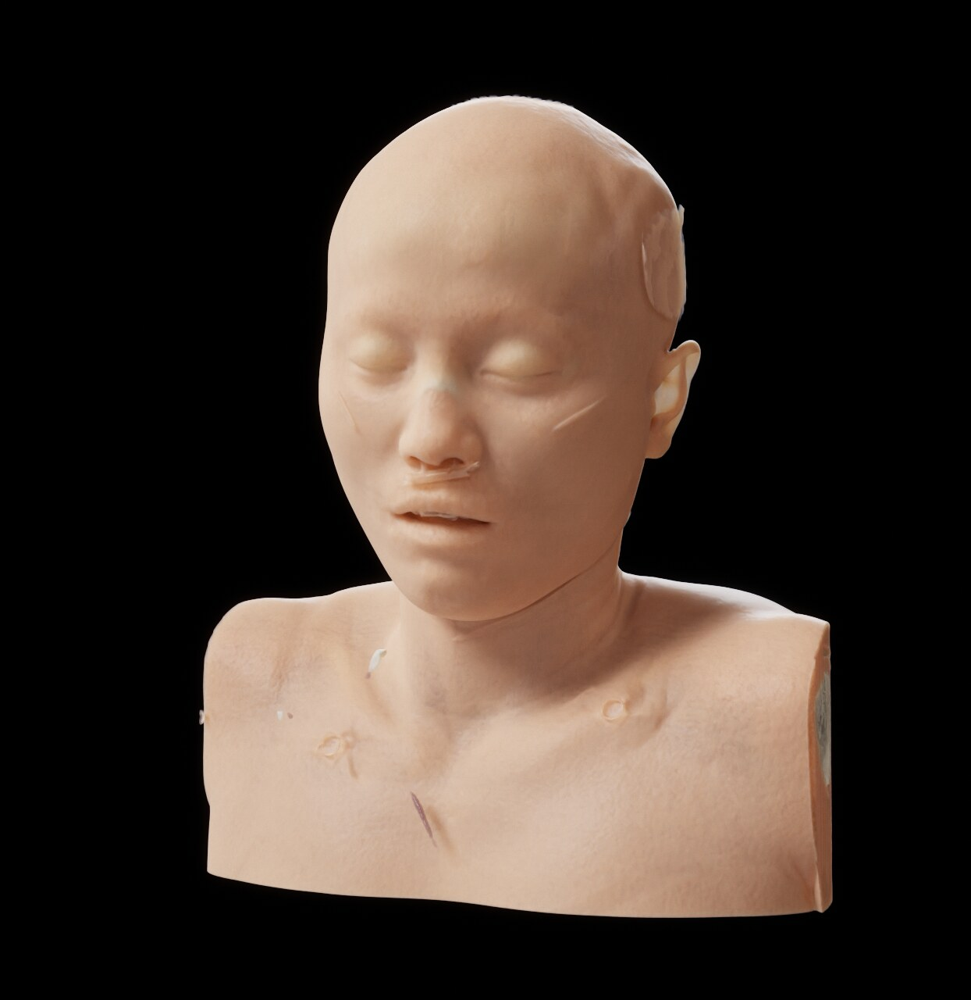
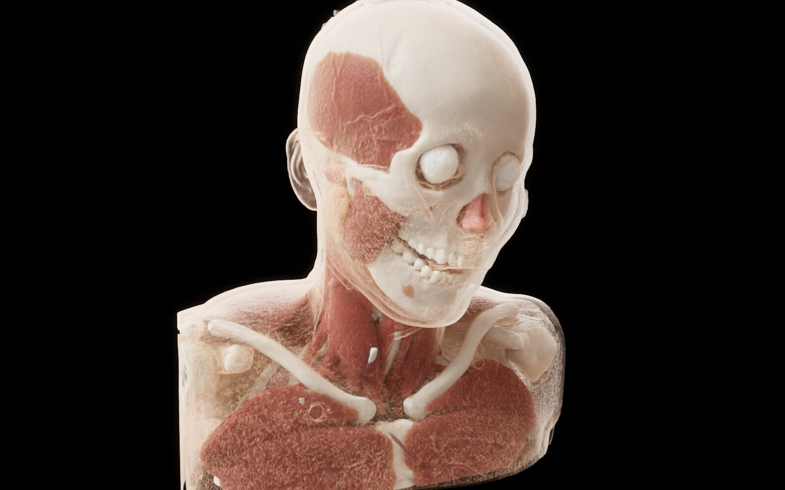
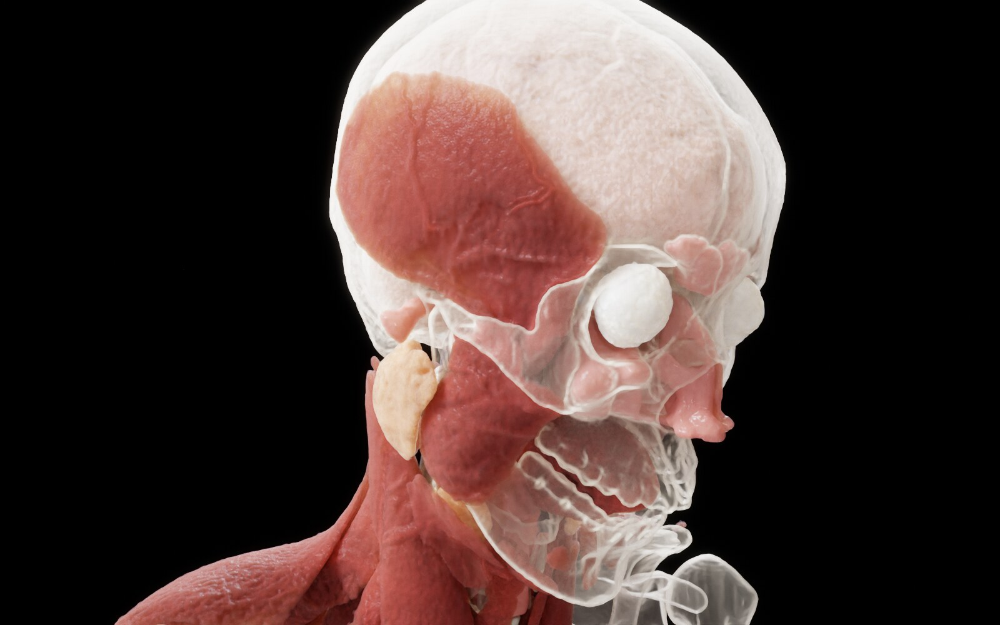
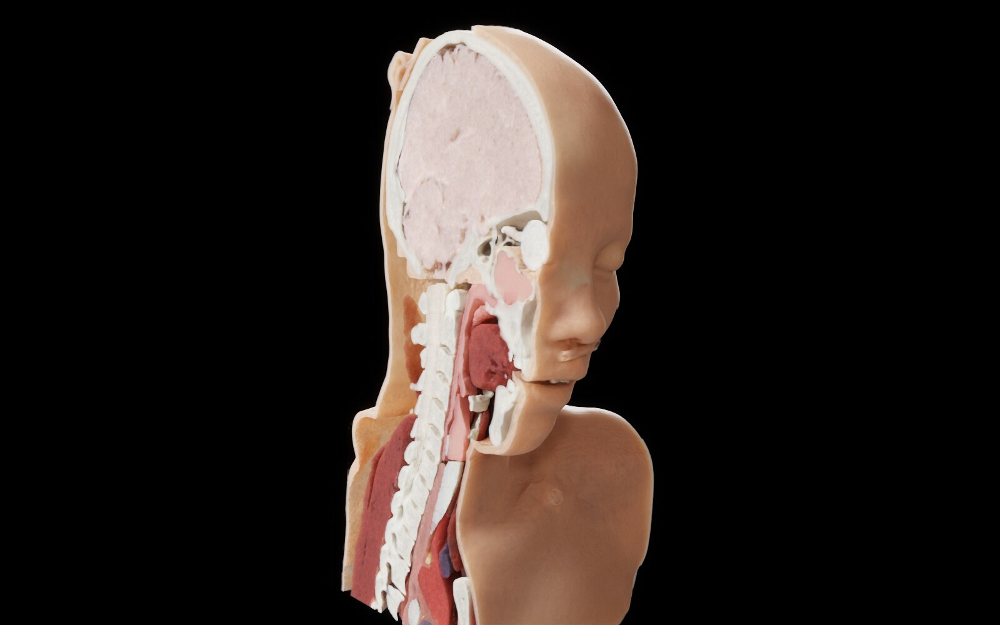
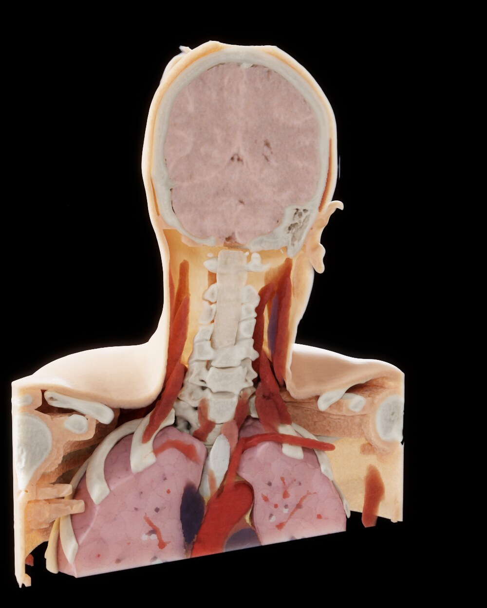
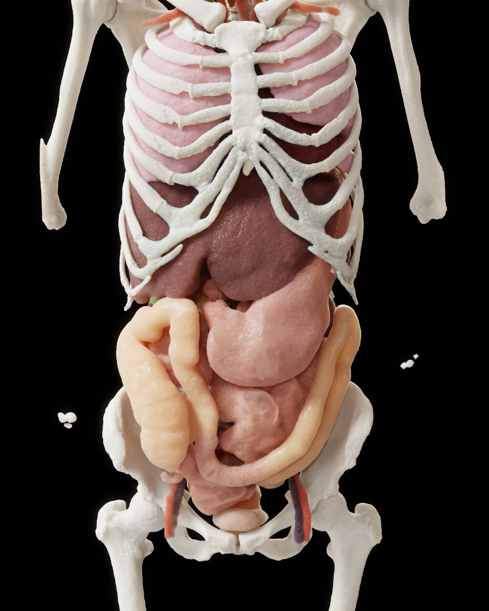
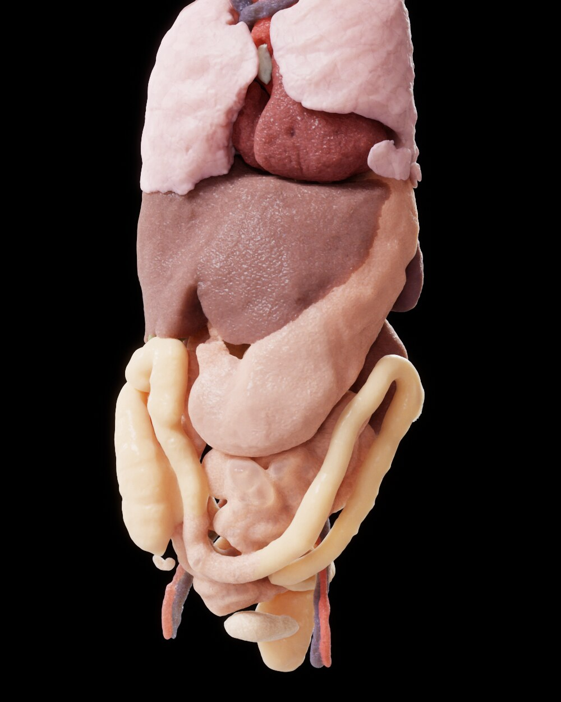

# volview

Photorealistic rendering of CT scans. volview loads a DICOM CT series, segments it
into more than 200 anatomical structures with TotalSegmentator, and renders the
result on the GPU (Vulkan): interactively with a ray marcher, or path traced and
denoised for final images. Every structure has its own anatomical material, so you
can show, ghost or hide skin, bone, muscle and organs, and cut away parts of the body.

<p align="center">
  
</p>

## Gallery

All images are path traced at 1024 samples per pixel with the default anatomical
materials. Only the visibility of structures and the camera change between them.

| | |
|---|---|
|  |  |
| Skin ghosted over bone, muscle and lungs | Skin hidden and skull ghosted: temporalis and masseter, eyes, sinuses, salivary glands |
|  |  |
| Sagittal cutaway (`--clip sagittal:right`) | Coronal cutaway (`--clip coronal:anterior:-20`) |
|  |  |
| Torso with the skeleton, skin, muscle and fat hidden | The same organs with the skeleton hidden too |

Datasets: head/neck CTA from the Affiliated Hospital of Xuzhou Medical College
([Mendeley Data](https://data.mendeley.com/datasets/9wv3fkxstx/1), CC BY 4.0);
torso from the [Visible Human Project](https://www.nlm.nih.gov/research/visible/visible_human.html)
(female, NLM).

## How it works

```
DICOM series ──► volume (HU) ──► segmentation ──► label post-processing ──► GPU renderer ──► tone mapping
   volio            volio            seg              app (skin, bone,       render            render
                                                      context tissue)
```

### 1. Loading (`crates/volio`)

Reads a folder of single-frame DICOM slices (recursively), picks the largest CT series
unless `--series` is given, sorts the slices along their normal and builds a volume of
Hounsfield units with its patient-space geometry (LPS, millimetres). Compressed
transfer syntaxes (JPEG 2000, JPEG-LS) are decoded through `dicom-pixeldata`.

### 2. Segmentation (`crates/seg`)

A Rust port of the [TotalSegmentator](https://github.com/wasserth/TotalSegmentator)
inference pipeline, running nnU-Net models exported to ONNX
(`tools/totalseg/export_onnx.py`) through ONNX Runtime with TensorRT/CUDA, or the CPU:

- reorient to RAS and resample to 1.5 mm, exactly as TotalSegmentator's preprocessing
  (nibabel / `scipy.ndimage.zoom` semantics);
- run the five "total" part models with nnU-Net sliding windows and Gaussian tile
  blending, streaming the logits so memory stays one tile deep;
- run finer subtasks (head and neck muscles, craniofacial structures, head glands and
  cavities, lung vessels, abdominal muscles, ...) on the bounding box of the region
  they cover, and paste their labels over the result;
- resample back to the CT's grid.

Besides the hard labels, the segmenter keeps a *soft* segmentation: the margin between
the best and second-best class on the model grid. It is zero on the predicted
boundary and varies smoothly, so the renderer can place label boundaries with
sub-voxel precision instead of drawing 1.5 mm staircases. `tools/totalseg/compare.py`
checks the port against upstream TotalSegmentator by per-class Dice.

Results are cached per series in `~/.cache/volview/labels/`; the viewer opens
immediately and segments in the background on first load.

### 3. Label post-processing (`crates/app`)

The segmentation leaves out things a realistic render needs, so the app adds them
from the CT itself:

- **Skin**: a thin shell at the body surface (the largest connected soft-tissue
  component), so the body can be drawn opaque or as translucent context. Tables,
  head holders and cables outside the body are labelled separately and hidden.
- **Bone**: thin bony plates the model misses at 1.5 mm (nasal bones, orbital and sinus
  walls), grown from labelled bone through dense voxels.
- **Context tissue**: the fat and connective tissue packing the gaps between organs,
  so organs don't float in empty space.

Labels are grouped (skin, fat, skeleton, lungs, heart & vessels, digestive,
urogenital, muscles, other); each group or label can be shown, ghosted or hidden, and
each label has an anatomical colour, roughness, subsurface amount and wet clear coat.

### 4. Rendering (`crates/render`, `shaders/`)

A Vulkan compute renderer. The CT density is filtered with a cubic B-spline (no voxel
or slice terraces) and coloured by a transfer function (bone, angio and soft-tissue
presets) and, in the label modes, by the label materials. Label boundaries come from
smoothed masks (and the soft segmentation), so surfaces stay smooth; in *hybrid* mode
the surface follows CT intensity edges and the albedo carries the CT's texture.

**Real time** (`dvr.comp`): emission-absorption ray marching with empty-space skipping
over 8³ bricks, GGX surface shading on Sobel normals, a precomputed shadow volume for
the key light (`shadow.comp`), an ambient-occlusion volume (`ao.comp`) and an
approximation of subsurface scattering.

**Path tracing** (`pt.comp`): progressive Monte Carlo path tracing of the volume after
Exposure Render (Kroes et al. 2012):

- free-flight sampling with delta/ratio tracking against per-brick majorants;
- surface-like points reflect with a GGX BRDF plus clear coat; elsewhere light scatters
  in the volume with a forward-scattering Henyey-Greenstein phase function, and
  subsurface tissue random-walks light beneath its surface;
- tissue is more transparent to red than to blue, tracked with spectral (hero-wavelength)
  MIS, so thin tissue glows reddish like real skin;
- an area key light and an HDR environment map are sampled at every event and combined
  with BSDF sampling by multiple importance sampling; a thin lens gives depth of field;
- the result is denoised with Intel Open Image Denoise (sharing memory with Vulkan, on
  the same GPU) or an edge-avoiding à-trous filter.

**Finishing** (`bloom.comp`, `tonemap.comp`): auto exposure metered on the drawn
anatomy, bloom, vignette, film grain and ACES tone mapping.

### 5. Viewer and scenes

The viewer (winit + egui) exposes all settings in a side panel: transfer function,
label modes and per-label looks, clip planes, lighting, path tracing and camera
finishing. **Ctrl+S** saves a *scene*: dataset, settings, camera and label looks as
JSON. Reopen it with `--scene`, or render it headless with `--scene ... --screenshot`.

## Building

Requirements:

- Rust 1.95 or newer
- a Vulkan 1.3 GPU and driver, and `glslangValidator` (shaders are compiled at build time)
- [Open Image Denoise 2.5.1](https://github.com/RenderKit/oidn/releases), unpacked to
  `data/oidn` (see `.cargo/config.toml`)
- for GPU segmentation: CUDA 13, cuDNN 9 and TensorRT 10 libraries, either on the
  system or unpacked to `data/cuda13` (override with `VOLVIEW_CUDA_DIR`); otherwise
  pass `--cpu`

```sh
cargo build --release
```

### Segmentation models

Export TotalSegmentator's models to ONNX once, from a Python environment with
TotalSegmentator and PyTorch installed (the weights are downloaded on first use):

```sh
python tools/totalseg/export_onnx.py data/models/totalseg
```

volview looks for them in `data/models/totalseg`, `$VOLVIEW_MODELS`, or `--models DIR`.
Without models it still renders, using the transfer function only.

### Light map

The default environment is `data/hdri/studio_small_09_2k.hdr`
([Poly Haven](https://polyhaven.com/a/studio_small_09), CC0). Any equirectangular
Radiance `.hdr` works with `--env-map`; without one, a procedural studio is used.

## Usage

```sh
# Interactive viewer
volview path/to/dicom

# Pick a series
volview path/to/dicom --list-series
volview path/to/dicom --series 1.2.840...

# Headless, path-traced image (512 paths per pixel by default)
volview path/to/dicom --skin hidden --hide muscles,fat --screenshot out.png --size 1600 1000

# Re-render a scene saved in the viewer
volview --scene scene.json --screenshot out.png --path-trace 1024

# Segment only, write the labels as NIfTI (+ JSON with label names)
volview path/to/dicom --seg-out labels.nii.gz
```

Commonly used options (`volview --help` lists all of them):

| Option | Effect |
|---|---|
| `--preset bone\|angio\|"soft tissue"` | transfer function |
| `--label-mode off\|tint\|isolate\|hybrid` | how labels are used (default hybrid) |
| `--skin ghost\|shown\|hidden` | how the skin is drawn |
| `--ghost GROUPS`, `--no-ghost` | groups drawn translucent (default skeleton) |
| `--hide GROUPS` | groups to hide: skin, fat, skeleton, lungs, heart, digestive, urogenital, muscles, other |
| `--clip PLANE:SIDE[:MM]` | cutaway, e.g. `coronal:anterior`, `axial:superior:-40` (repeatable) |
| `--view YAW PITCH`, `--zoom`, `--pan DX DY` | camera |
| `--path-trace N`, `--realtime` | path trace N samples, or use the ray marcher |
| `--aperture MM`, `--focus-at U V` | depth of field |
| `--denoiser oidn\|atrous\|off` | path-tracing denoiser |
| `--cpu`, `--no-segment`, `--labels NII` | segmentation control |

Viewer controls: drag to orbit, Shift/middle drag to pan, right drag or wheel to zoom,
Ctrl+click to focus, double-click or **R** to reset the view, **1**–**3** for the
transfer-function presets, **F**/**F11** for fullscreen, **Ctrl+S** to save the scene,
**Esc** to quit.

## Repository layout

| Path | Contents |
|---|---|
| `crates/volio` | DICOM series discovery and loading |
| `crates/seg` | TotalSegmentator inference (ONNX Runtime), NIfTI I/O, soft segmentation |
| `crates/render` | Vulkan renderer, environment lighting, OIDN integration |
| `crates/app` | the `volview` binary: CLI, viewer UI, label post-processing, scenes |
| `shaders/` | GLSL compute shaders (ray marcher, path tracer, lighting volumes, denoiser, tone mapping) |
| `tools/totalseg/` | ONNX export of the TotalSegmentator models and a Dice comparison tool |
| `docs/images/` | README images |
